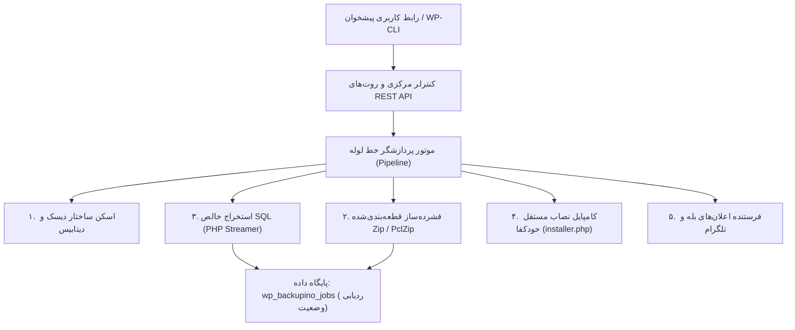

# ۲. کالبدشکافی معماری فنی و موتورهای هسته بکاپینو

> **بخش:** شروع به کار • **نسخه پایدار:** ۱.۰.۰ رسمی • **آخرین به‌روزرسانی:** نوامبر ۲۰۲۶  
> **مخاطب:** توسعه‌دهندگان PHP، مدیران سرور و معماران نرم‌افزار

---

## 🏗️ نمای کلی معماری (High-Level Architecture)

بکاپینو با رویکرد مدرن، شیءگرا و با تفکیک کامل لایه‌های پردازشی (Separation of Concerns) طراحی شده است. هیچ کدی متکی به ابزارهای سیستمی خارجی ناامن مانند `exec()` یا `mysqldump` نیست؛ همه‌چیز در لایه زبان استاندارد PHP بهینه و استریمینگ اجرا می‌شود:

---

## ⚙️ موتورهای چهارگانه هسته بکاپینو

### ۱. موتور اسکنر و فیلتر فایل‌ها (`Scanner` & `FileFilter`)
* **اسکن غیرمسدودکننده:** ساختار دایرکتوری‌ها به صورت پشته‌ای (Stack-based) اسکن می‌شود.
* **فیلترهای هوشمند پیش‌فرض:**
  * رد کردن خودکار پوشه‌های کش (`wp-content/cache`)
  * رد کردن پوشه بسته‌های قبلی بکاپینو (`wp-content/backupino`)
  * مستثنی کردن فایل‌های سنگین‌تر از سقف دلخواه کاربر (مثلاً فایل‌های بالای ۵۰ مگابایت)
  * امکان تعریف الگوهای سفارشی با فرمت گلبینگ (`*.mp4`, `node_modules/`, `logs/`)

### ۲. فشرده‌ساز قطعه‌بندی‌شده (`Archiver` & `Chunking`)
* اکثر هاست‌ها حین کار با فایل‌های بزرگ فشرده دچار کمبود حافظه می‌شوند.
* بکاپینو فایل‌ها را در دسته‌های مشخص (پیش‌فرض: ۳۰۰ فایل در هر تیک ایجکس) به آرشیو زیپ اضافه می‌کند.
* از کتابخانه بومی PHP `ZipArchive` استفاده می‌کند و در صورت عدم وجود آن، به صورت خودکار روی کتابخانه داخلی `PclZip` سوییچ می‌کند تا تحت هر شرایطی عملیات انجام پذیرد.

### ۳. موتور استخراج خالص پایگاه‌داده (`Pure PHP SQL Streamer`)
* بسیاری از هاست‌های اشتراکی تابع `exec()` یا دستور `mysqldump` را مسدود می‌کنند.
* بکاپینو مستقیماً از طریق PDO یا mysqli جداول را سطر به سطر خوانده و مستقیماً به صورت فایل `.sql` استریم می‌کند.
* **حفظ ۱۰۰٪ اسلاگ‌های فارسی:** بدون دستکاری توابع متنی وردپرس، انکودینگ UTF-8 و UTF8MB4 با تمام کاراکترهای اموجی و نامک‌های فارسی با استاندارد بالا استخراج می‌گردد.
* **تقسیم دستورات به قطعات ایمن:** برای جلوگیری از خطای `max_allowed_packet`، دستورات `INSERT` در بسته‌های بهینه چند کیلوبایتی دسته‌بندی می‌شوند.

### ۴. مانیفست و نصاب مستقل (`installer.php`)
* پس از پایان فشرده‌سازی و استخراج دیتابیس، یک فایل متنی با فرمت JSON به نام `manifest.json` شامل اطلاعات متادیتای سایت (نسخه وردپرس، پیشوند جداول، آدرس سایت، حجم فایل‌ها و چک‌سام) درون پکیج تزریق می‌شود.
* یک کپی اختصاصی از اسکریپت `installer.php` آماده شده و در کنار فایل زیپ در اختیار کاربر قرار می‌گیرد. اینستالر کاملاً ایزوله است و بدون نیاز به وجود وردپرس روی هاست مقصد اجرا می‌شود.

---

## 🔄 مکانیزم ضد تایم‌اوت و جدول ردیابی (`wp_backupino_jobs`)

هر عملیات پشتیبان‌گیری دارای یک ردیف در جدول اختصاصی دیتابیس با فیلدهای زیر است:
* `token`: شناسه یکتا ۳۲ کاراکتری عملیات
* `status`: وضعیت جاری (`queued`, `running`, `completed`, `failed`, `cancelled`)
* `stage`: مرحله جاری (`scan`, `files`, `database`, `finalize`)
* `progress`: درصد کلی پیشرفت (۰ تا ۱۰۰)
* `payload`: آرایه وضعیت JSON شامل آخرین فایل اسکن شده، آفست بایتی فایل دیتابیس، تعداد رکوردهای ثبت‌شده.

در صورتی که وب‌سرور اتصال را قطع کند یا مرورگر بسته شود:
1. پردازش در پس‌زمینه با سیستم هوشمند کرون و ایجکس زنده به کار خود ادامه می‌دهد.
2. با اولین درخواست مجدد کاربر یا تیک بعدی، پایپ‌لاین وضعیت ذخیره‌شده را از جدول دیتابیس خوانده و کار دقیقاً از همان سطر جدول یا همان فایل دیسک ادامه می‌یابد.

---

## 🧹 پاکسازی خودکار دیسک (Zero Garbage Guarantee)

در پوشه `wp-content/backupino/`:
* پوشه `jobs/`: برای نگهداری فایل‌های موقت، تکه‌های فشرده‌سازی و لاگ‌های در حال اجرا.
* **پاکسازی تضمینی:** به محض اتمام موفقیت‌آمیز عملیات یا فشرده شدن دکمه **لغو (Cancel)**، محتویات پوشه موقت مربوط به آن عملیات به صورت کامل حذف می‌شود و تنها فایل فشرده نهایی و اینستالر در پوشه محافظت‌شده `packages/` باقی می‌ماند.

---

## 🧭 گام بعدی

برای بررسی پیش‌نیازهای میزبانی و ماژول‌های PHP، سند زیر را مطالعه نمایید:  
👉 [**پیش‌نیازهای سیستمی و سازگاری سرور**](03-system-requirements.md)

