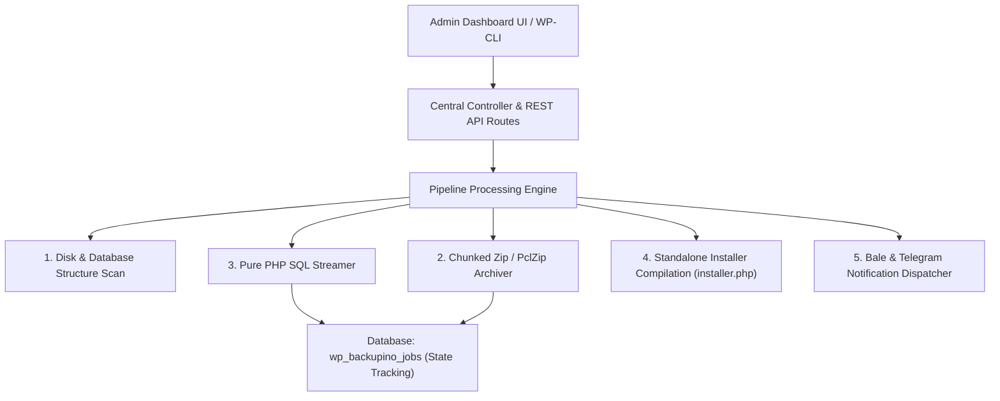

# 2. Technical Architecture & Core Engines Breakdown

> **Section:** Getting Started • **Stable Version:** 1.0.1 GA • **Last Updated:** November 2026  
> **Target Audience:** PHP Developers, Server Administrators, and Software Architects

---

## 🏗️ High-Level Architecture Overview

Backupino is built with a modern, object-oriented design emphasizing strict separation of concerns. The codebase contains zero reliance on insecure shell commands like `exec()` or external system binaries such as `mysqldump`. All workflows execute in pure, highly-optimized PHP streaming pipelines:

---

## ⚙️ The Four Core Engines of Backupino

### 1. File Scanner & Filter Engine (`Scanner` & `FileFilter`)
* **Non-Blocking Traversal:** File system trees are traversed using a stack-based, non-recursive algorithm to prevent stack overflow errors on deeply nested directories.
* **Intelligent Default Filters:**
  * Automatically ignores transient cache folders (`wp-content/cache`).
  * Automatically excludes Backupino's internal archive directory (`wp-content/backupino`).
  * Excludes heavy files exceeding custom size thresholds (e.g., individual files above 50MB).
  * Supports custom globbing exclusion rules (`*.mp4`, `node_modules/`, `*.log`, `storage/logs/`).

### 2. Resumable Chunk-Based Archiver (`Archiver` & `Chunking`)
* Avoids server memory limits by processing archives incrementally rather than compressing the entire file system in one pass.
* Groups files into discrete, manageable batches (default: 300 files per execution tick) appended sequentially to the zip container.
* Automatically prioritizes PHP's native `ZipArchive` extension for maximum speed. When unavailable, it seamlessly falls back to an internal pure-PHP `PclZip` adapter, guaranteeing compatibility across any hosting stack.

### 3. Pure PHP SQL Streamer (`Pure PHP SQL Streamer`)
* Traditional backup tools fail on shared hosting where `exec()`, `passthru()`, or system `mysqldump` are disabled.
* Backupino connects directly via `PDO` or `mysqli`, streaming table rows line-by-line straight into an unbuffered `.sql` file.
* **100% Unicode & Non-ASCII Slug Preservation:** Extracts database records without intermediate string manipulation, preserving UTF-8 and UTF8MB4 encodings, 4-byte emojis, and complex non-Latin URL slugs intact.
* **Safe Batch Generation:** Inserts are segmented into optimized multi-row batches designed to stay well beneath MySQL's `max_allowed_packet` limit.

### 4. Manifest Generator & Standalone Installer (`installer.php`)
* Upon archive finalization, Backupino generates a structured `manifest.json` file containing comprehensive site metadata (WordPress core version, table prefixes, source URLs, absolute paths, total file count, and cryptographic checksums).
* A self-executing Standalone Installer (`installer.php`) is packaged alongside the zip archive. The installer is completely decoupled from the WordPress runtime and can be executed on a clean, empty web server.

---

## 🔄 Anti-Timeout Mechanism & State Tracking (`wp_backupino_jobs`)

Every backup operation is tracked within a dedicated database table (`wp_backupino_jobs`) using the following schema:
* `token`: Unique 32-character hexadecimal job identifier.
* `status`: Current job state (`queued`, `running`, `completed`, `failed`, `cancelled`).
* `stage`: Active pipeline phase (`scan`, `files`, `database`, `finalize`).
* `progress`: Overall completion percentage (0 to 100).
* `payload`: JSON-encoded execution state containing the last processed file pointer, database table byte offsets, and row counters.

If a web server drops the connection, hits a gateway timeout, or the browser tab is closed:
1. The process continues in the background orchestrated by WP-Cron and scheduled asynchronous ticks.
2. Upon the next client request or cron heartbeat, the pipeline loads the exact state from `wp_backupino_jobs` and resumes seamlessly from the exact file or database row.

---

## 🧹 Zero Garbage Guarantee (Automatic Cleanup)

Within the storage directory `wp-content/backupino/`:
* `jobs/`: Staging directory storing active task chunks, split SQL dumps, and ephemeral runtime logs.
* **Guaranteed Disk Cleanup:** As soon as an operation completes successfully or is aborted via the **Cancel** button, all transient data in the staging folder is instantly wiped. Only the finalized archive package and standalone installer remain inside the protected `packages/` directory.

---

## 🧭 Next Step

To review hosting prerequisites, required PHP extensions, and server configurations:  
👉 [**System Requirements & Server Compatibility**](03-system-requirements.md)
